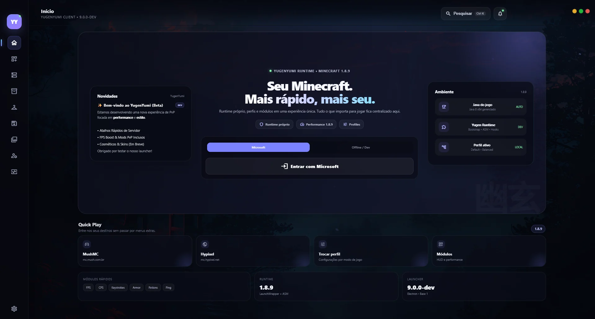
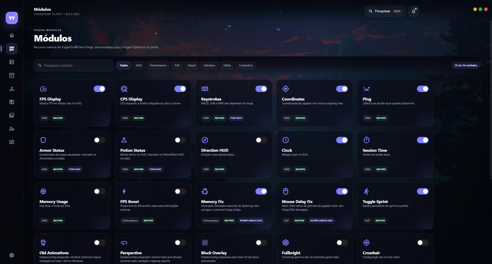
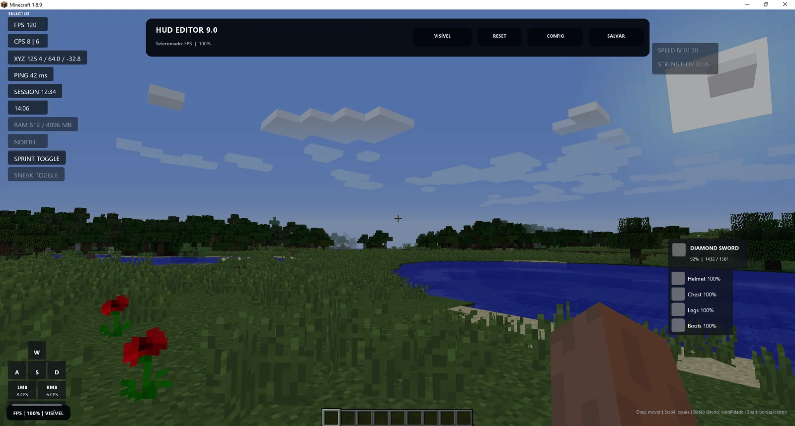
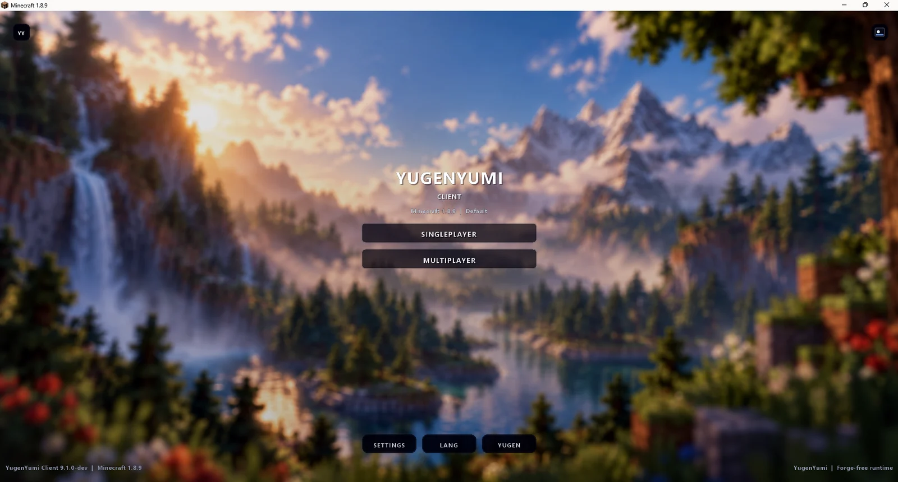

<div align="center">


# YugenYumi Client & Launcher

**Seu Minecraft. No seu estilo.**

Site oficial de apresentação do **YugenYumi Client & Launcher**, um projeto independente de personalização para **Minecraft Java 1.8.9**, com Launcher próprio, HUDs configuráveis e identidade visual inspirada em cenários noturnos.


**[Conheça o projeto](#-sobre-o-yugenyumi) · [Galeria](#-galeria) · [Desenvolvimento](#-estado-do-desenvolvimento) · [Como executar o site](#-executar-o-site-localmente)**

</div>

---

## ✨ Sobre o YugenYumi

O **YugenYumi** reúne um **Launcher para Windows**, recursos próprios para **Minecraft 1.8.9**, personalização de HUDs e uma experiência visual consistente. O projeto está em desenvolvimento ativo: alguns recursos já foram validados em testes Windows, enquanto outros ainda exigem correções e ajustes.

Este repositório contém o **site de apresentação** do projeto. Ele não é o instalador do jogo e não substitui o código-fonte completo do Client & Launcher.

### Recursos apresentados

- **Launcher personalizado:** inicialização do Minecraft, gerenciamento de Java 8, perfis, servidores, configurações e diagnósticos.
- **HUDs e módulos:** FPS, CPS, Keystrokes, Armor Status, Item Status, Potion Status e outras opções de personalização.
- **HUD Editor:** ajuste de posição, escala e aparência dos elementos na tela.
- **Wallpapers:** seleção entre cinco fundos para o menu do Minecraft.
- **Cosméticos:** área de prévia 3D e Wings em desenvolvimento e refinamento.
- **Setup Premium:** instalador com interface própria e identidade YugenYumi, atualmente em testes Beta.
- **Discord Rich Presence:** atividade do YugenYumi com o símbolo YY oficial.

> **Nota de transparência:** recursos como Perspective/Freelook, Motion Blur, acabamento das Wings e Preview 3D ainda possuem pendências conhecidas. As capturas da galeria incluem referências históricas de versões anteriores; não representam necessariamente funcionalidades aprovadas na 16.6.1-dev.

## 🖼️ Galeria

As imagens abaixo estão incluídas no próprio repositório.

| Launcher | Módulos |
|:--:|:--:|
|  |  |

| Personalização de HUD | Menu do Minecraft |
|:--:|:--:|
|  |  |

A galeria completa do site inclui telas do Launcher, configurações, cosméticos, capturas em jogo e registros dos testes.

## 🚧 Estado do desenvolvimento

| Componente | Situação |
|---|---|
| Site de apresentação V3 | Prévia disponível neste repositório |
| Launcher e Minecraft Client | **16.6.1-dev — Beta em validação** |
| Setup Premium | Instalação por usuário testada no Windows; demais cenários ainda requerem homologação |
| Discord Rich Presence | Logo YY confirmado em teste real |
| Preview 3D, Wings, Freelook e Motion Blur | Ajustes e correções pendentes |
| Download público | **Indisponível até uma release aprovada** |

**O YugenYumi ainda não foi lançado como versão Stable.** Não há um link público de instalação autorizado neste README.

## 🗂️ Estrutura deste repositório

```text
.
├── .github/
│   └── workflows/
│       └── pages.yml         # Publicação via GitHub Actions (quando configurada)
├── scripts/
│   └── check-site.js          # Verificação dos recursos estáticos
├── site/
│   ├── index.html             # Página principal
│   ├── styles.css             # Estilos e responsividade
│   ├── script.js              # Interações, navegação e galeria
│   ├── site-config.js         # Versão, imagens e configuração de release
│   ├── 404.html               # Página não encontrada
│   ├── .nojekyll
│   └── assets/                # Logos, imagens e screenshots
└── README.md
```

Se o workflow ainda não estiver no repositório, copie-o do pacote do site para `.github/workflows/pages.yml` antes de configurar o GitHub Pages.

## 💻 Executar o site localmente

O site utiliza **HTML, CSS e JavaScript**, sem precisar iniciar o Launcher ou instalar dependências npm para visualizá-lo.

1. Baixe ou clone o repositório.
2. Abra um terminal na pasta principal do repositório.
3. Execute os comandos abaixo:

```bash
# Conferir os recursos estáticos (requer Node.js)
node scripts/check-site.js

# Servidor local (requer Python 3)
cd site
python -m http.server 8000
```

Abra **http://localhost:8000/** no navegador. Para interromper o servidor, pressione `Ctrl + C`.

## 🌐 Publicação no GitHub Pages

O pacote do site inclui um workflow que publica **somente a pasta `site/`**, usando GitHub Actions.

1. Confirme que `.github/workflows/pages.yml` existe na branch `main`.
2. Em **Settings → Pages**, selecione **GitHub Actions** como origem de publicação.
3. Verifique se `site/site-config.js` contém o endereço correto do repositório.
4. Execute `node scripts/check-site.js` e confira as imagens e os links.
5. Depois de autorizar a publicação, acompanhe a execução na aba **Actions**.

O endereço do site será exibido nas configurações do GitHub Pages após o primeiro deploy bem-sucedido. Não há uma URL pública confirmada neste documento.

### Downloads e releases

O download do Client permanece intencionalmente desabilitado em `site/site-config.js` (`releaseUrl: null`). Somente após a aprovação de um instalador real deverão ser informados a URL oficial do GitHub Release, a versão, o tamanho e o hash SHA-256 verificados.

## 🛠️ Tecnologias

**Site:** HTML5, CSS3, JavaScript e GitHub Pages.

**Ecossistema apresentado:** Electron, Node.js, Java 8, Minecraft Java 1.8.9 e componentes de renderização próprios. Esses componentes **não fazem parte da hospedagem estática do site**.

## 📌 Acompanhamento e feedback

Problemas no site, sugestões de navegação e erros visuais podem ser registrados em [Issues deste repositório](https://github.com/carlosvcl/yugenguimi-launcher/issues). Antes de publicar logs, remova tokens, informações de contas e outros dados pessoais.

## ⚖️ Avisos

YugenYumi é um **projeto independente**, não oficial, sem afiliação ou endosso da Mojang Studios, Microsoft ou Discord. Minecraft e demais marcas citadas pertencem aos respectivos titulares. A utilização ou redistribuição de materiais de terceiros depende das licenças correspondentes.

Este README não concede, por si só, uma licença de redistribuição do código ou dos recursos do projeto.

---

<div align="center">

**YugenYumi Client & Launcher · 16.6.1-dev**  
*Uma experiência personalizada. Em evolução.*

</div>
